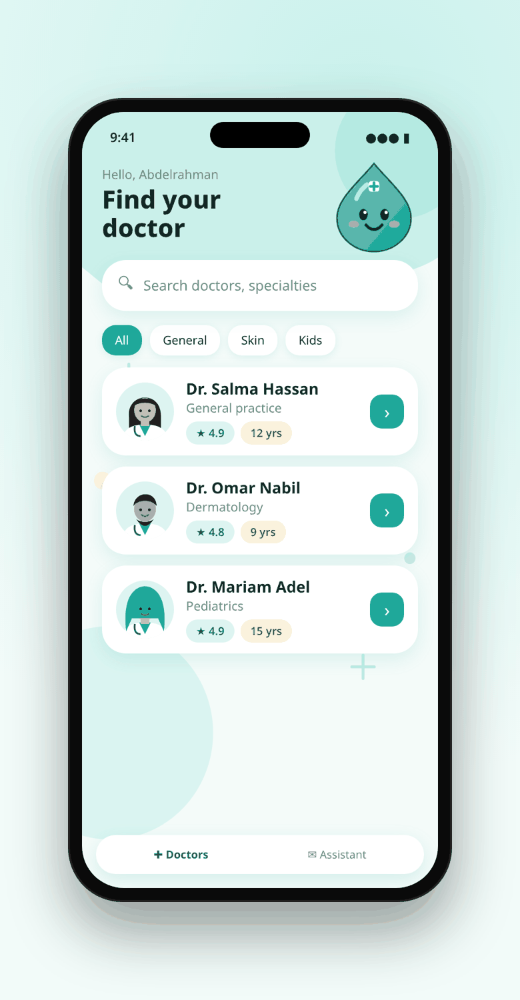
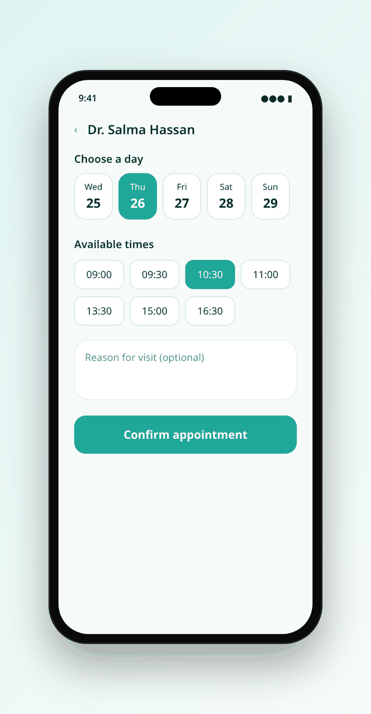
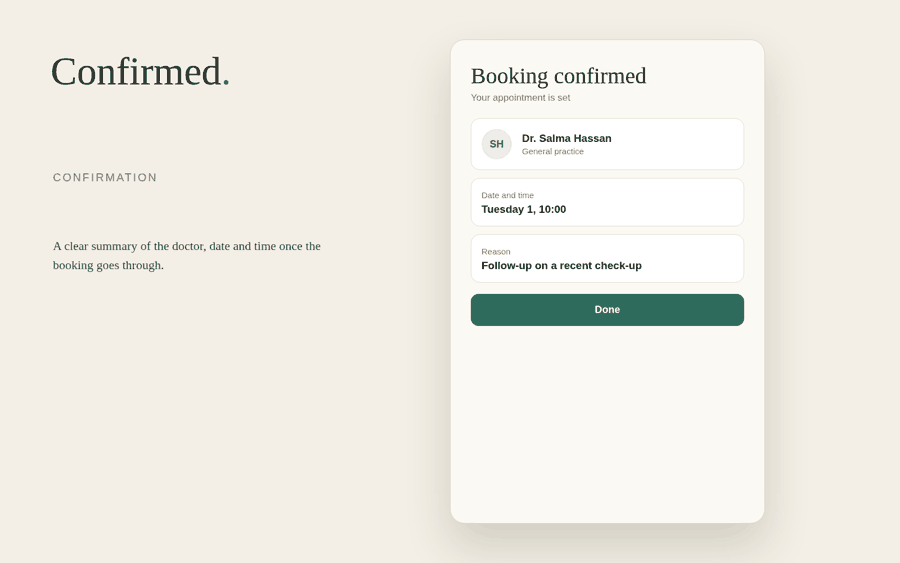
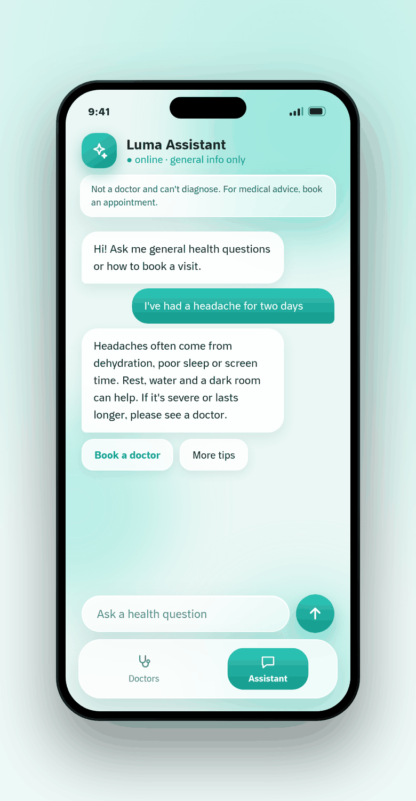

# Luma Care

A clinic appointment app built with Flutter, with a streaming AI health-assistant chat. Soft teal and white design.

> The Dart code has unit tests but has **not yet been run on a device or emulator**. The images in `docs/screens` are the designed screens, not recordings of the running app.

## Screens

| Doctors | Booking | Confirmation | AI assistant |
|---|---|---|---|
|  |  |  |  |

## What it shows

- **Appointment flow.** Doctor list, day and time selection, optional reason, confirmation screen.
- **AI chat with streaming replies.** Text appears chunk by chunk, like a model typing. The chat talks to a `ChatService` interface: an offline mock for development, and a `ProxyChatService` that streams from your own backend (server-sent events).
- **Safety layer.** `SafetyGuard` checks every message before it reaches the model. Emergency wording (chest pain, trouble breathing and similar) gets fixed, reviewed copy telling the user to call emergency services, and the model is never called. A visible disclaimer says the assistant is not a doctor. If the backend fails, a fallback message points to booking a visit.

## Architecture

```
lib/
  main.dart                    wiring, mock vs proxy chosen by build flag
  theme/app_theme.dart         design tokens + ThemeData
  models/                      Doctor, Appointment, ChatMessage
  services/
    clinic_repository.dart     ClinicRepository -> Mock (swap for REST/Firestore)
    chat_service.dart          ChatService -> MockChatService | ProxyChatService
    safety_guard.dart          emergency detection + fixed copy
    chat_controller.dart       chat state (ChangeNotifier): guard -> stream -> fallback
  screens/                     shell, doctors, booking, confirmation, chat
  widgets/                     chat bubble
```

## Run it

Generate the platform folders first:

```bash
flutter create . --project-name luma_care --org dev.example
flutter pub get
flutter run                      # offline mock assistant, no keys needed
flutter test
```

Real model through your backend:

```bash
flutter run --dart-define=CHAT_URL=https://your-backend/chat
```

Backend contract: `POST` with `{"system": "...", "messages": [{"role": "user", "content": "..."}]}`, responds with lines like `data: {"delta":"text"}` and a final `data: [DONE]`. The provider API key stays on the server.

## Known limits

- Untested on device (see note above).
- Appointments are mocked in memory. No accounts, payments or real scheduling.
- Keyword-based emergency detection is a first safety layer only. A real medical product needs clinical review, logging and privacy compliance.
- General information only. Not medical advice.
